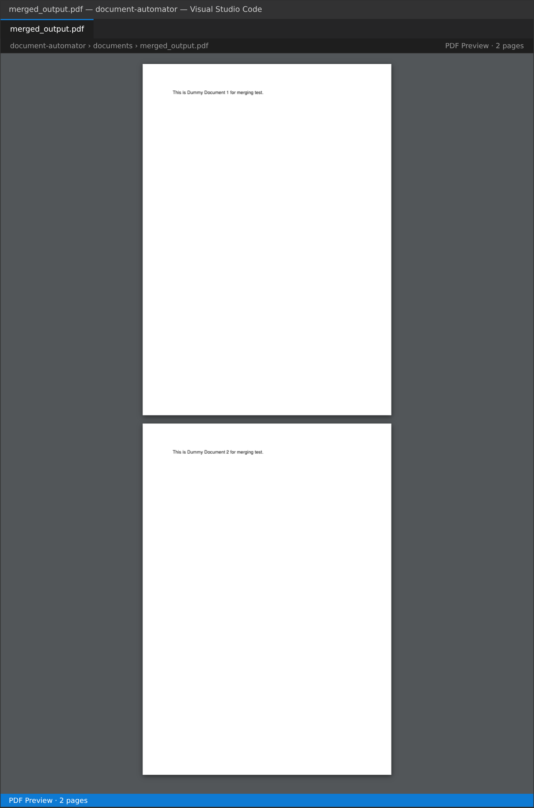
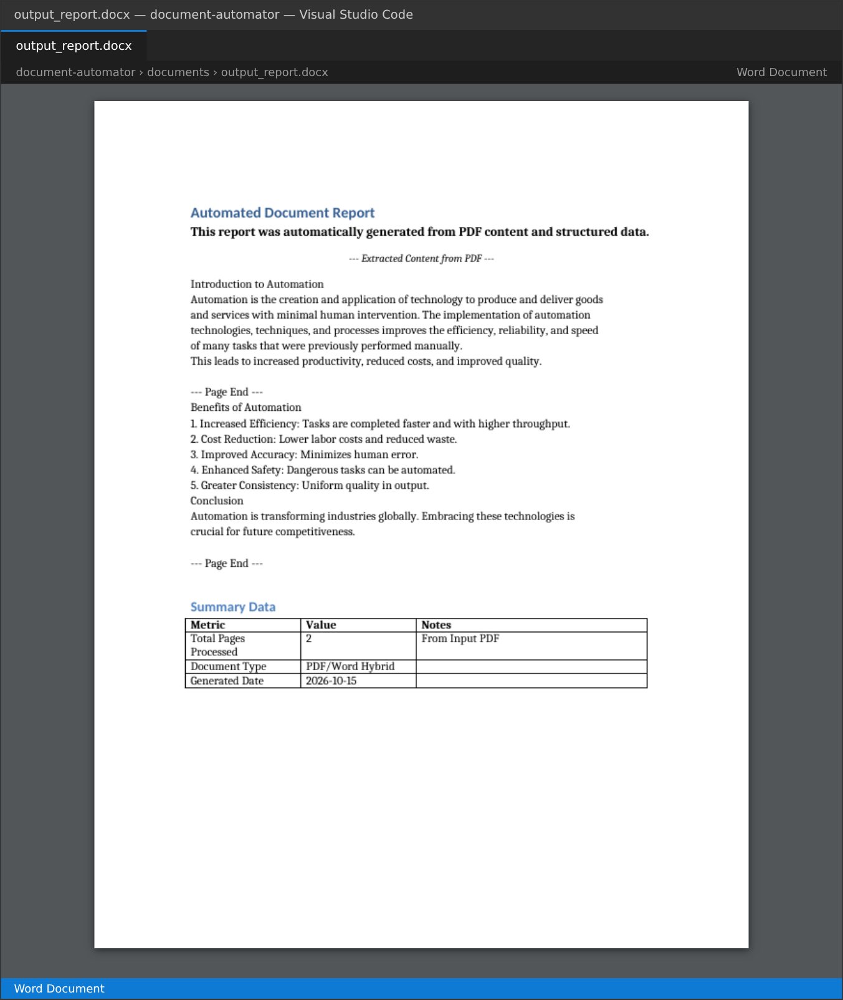

# Lab Week 11: Automating PDFs & Word Documents

SP352301 Script Programming — ภาคเรียน 1/2569

โปรเจกต์นี้ใช้ `PyPDF2` ดึงข้อความจาก PDF และรวม (merge) / แยก (split) ไฟล์ PDF และใช้ `python-docx` สร้างรายงาน Word (`.docx`) ที่มีหัวข้อ ย่อหน้าจัดรูปแบบ และตาราง

## Key Concepts Demonstrated

* **PDF Text Extraction** — `PdfReader`, `reader.pages`, `page.extract_text()`
* **PDF Merging** — `PdfWriter`, `writer.add_page()`, `writer.write()`
* **PDF Splitting** — แยก PDF เป็นไฟล์ย่อยตามจำนวนหน้า (`split_pdf`)
* **Word Document Creation** — `docx.Document()`, `add_heading()`, `add_paragraph()`, `add_table()`, `save()`
* **Formatting** — ตัวหนา ตัวเอียง ขนาดฟอนต์ (`Pt`) จัดกึ่งกลาง ตารางแบบ `Table Grid`
* **Modular Design** — แยก `pdf_processor.py`, `word_processor.py`, `utils.py`
* **Logging & Error Handling** — แจ้งสถานะทุกขั้นตอนและจัดการไฟล์ที่หายหรือเสีย

## Setup & How to Run

```bash
git clone https://github.com/sarid101/document-automator.git
cd document-automator
python -m venv .venv
.venv\Scripts\activate          # macOS/Linux: source .venv/bin/activate
pip install PyPDF2 python-docx reportlab
python create_documents.py      # สร้าง input_article.pdf, dummy_doc1.pdf, dummy_doc2.pdf
python main.py
```

`reportlab` ใช้เฉพาะใน `create_documents.py` สำหรับสร้างไฟล์ PDF ตัวอย่าง (ไฟล์ทั้งสามมีอยู่ในโฟลเดอร์ `documents/` แล้ว)

### สคริปต์จะทำงานดังนี้

1. ดึงข้อความจาก `documents/input_article.pdf` (2 หน้า)
2. สร้าง `documents/output_report.docx` ประกอบด้วย
   * หัวข้อ **Automated Document Report**
   * ย่อหน้าตัวหนา 12pt และข้อความตัวเอียงจัดกึ่งกลาง
   * ข้อความที่ดึงจาก PDF (คั่นแต่ละหน้าด้วย `--- Page End ---`)
   * หัวข้อ **Summary Data** และตาราง 4 แถว × 3 คอลัมน์ (จำนวนหน้า, ประเภทเอกสาร, วันที่สร้าง)
3. รวม `dummy_doc1.pdf` + `dummy_doc2.pdf` เป็น `documents/merged_output.pdf` (2 หน้า)

## Screenshots

### `documents/merged_output.pdf`



### `documents/output_report.docx`



## Project Structure

```
document-automator/
├── src/
│   ├── __init__.py          # Python package marker
│   ├── pdf_processor.py     # PyPDF2: extract / merge / split
│   ├── word_processor.py    # python-docx: heading / paragraph / table / picture / save
│   └── utils.py             # Logging และสร้างโฟลเดอร์
├── documents/
│   ├── input_article.pdf    # PDF สำหรับดึงข้อความ (input)
│   ├── dummy_doc1.pdf       # PDF สำหรับทดสอบ merge (input)
│   ├── dummy_doc2.pdf       # PDF สำหรับทดสอบ merge (input)
│   ├── output_report.docx   # สร้างโดยสคริปต์ (อยู่ใน .gitignore)
│   └── merged_output.pdf    # สร้างโดยสคริปต์ (อยู่ใน .gitignore)
├── screenshots/             # ภาพผลลัพธ์
├── create_documents.py      # สร้างไฟล์ PDF input ตัวอย่าง
├── main.py                  # จุดเริ่มต้นโปรแกรม
├── lab_week11_colab.ipynb   # Notebook สำหรับรันบน Google Colab
├── .gitignore
└── README.md
```

## หมายเหตุการแก้โค้ดจากต้นฉบับ

* **Import:** เปลี่ยน `from .utils import ...` เป็น `from utils import ...` เพราะ `main.py` เพิ่ม `src` เข้า `sys.path` แล้ว import แบบไม่ใช่ package (relative import จะ error)
* **`split_pdf`:** ต้นฉบับเขียน `range(0_int, ...)` ซึ่งเป็น SyntaxError ทำให้ทั้งไฟล์ import ไม่ได้ แก้เป็น `range(0, ...)` และเพิ่ม import `ensure_directory_exists` ที่ขาดไป
* **`datetime`:** ย้าย `import datetime` ไปไว้บนสุดของ `main.py` (ต้นฉบับ import ไว้ใต้ `if __name__ == "__main__"` ซึ่งจะพังถ้าเรียก `main()` จากที่อื่น)
* **`add_table`:** ตั้งความกว้างให้ทุกเซลล์ด้วย เพราะ Word อ่านความกว้างจากเซลล์ ไม่ใช่จากคอลัมน์
* **`extract_text()`:** กันกรณีคืนค่า `None` (หน้า PDF ที่เป็นรูปภาพ) ด้วย `or ""`
* ใช้ `os.path.abspath(__file__)` ให้หาโฟลเดอร์ `documents` เจอไม่ว่าจะรันจากที่ไหน และตั้ง `logger.propagate = False` กัน log ซ้ำ

## Debugging Document Automation

* **`FileNotFoundError` / CRITICAL not found** — รัน `python create_documents.py` หรือวาง PDF ในโฟลเดอร์ `documents`
* **`ModuleNotFoundError: PyPDF2` / `docx`** — `pip install PyPDF2 python-docx` (ชื่อแพ็กเกจคือ `python-docx` แต่ import ว่า `docx`)
* **`PdfReadError`** — ไฟล์ PDF เสีย หรือถูกเข้ารหัส
* **Word ว่าง / ไม่มีข้อความ** — PDF แบบสแกน (รูปภาพ) ไม่มีข้อความให้ดึง
* **`PermissionError` ตอน save** — ปิด `output_report.docx` ใน Word ก่อนรันใหม่
